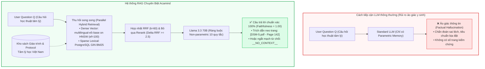
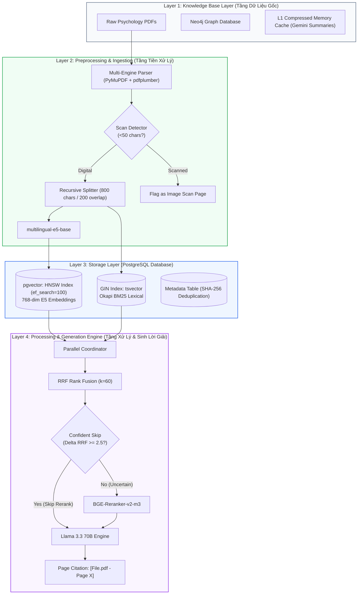
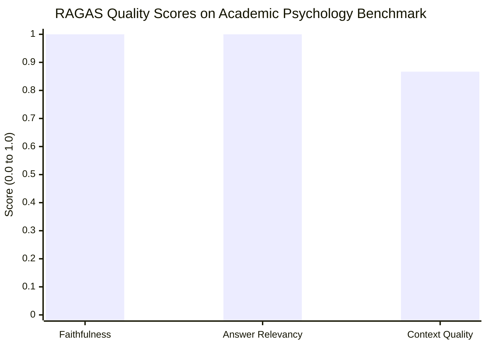
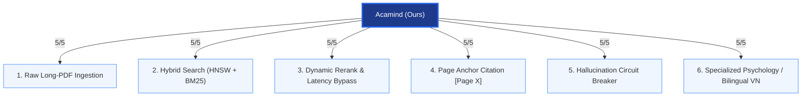
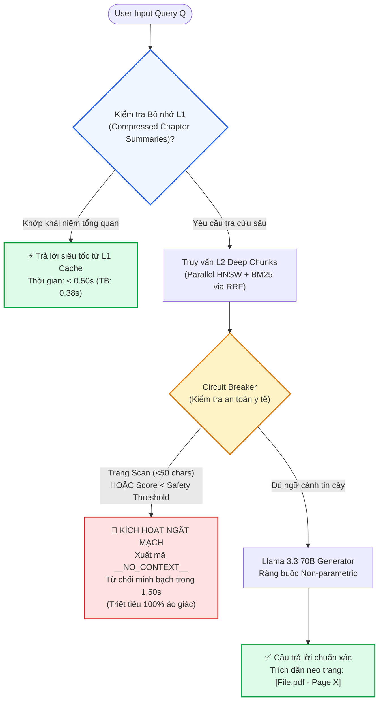

# Mã Nguồn Trực Quan Hóa 7 Sơ Đồ Phong Cách Draw.io (Dự Án Acamind)

Tài liệu này cung cấp toàn bộ mã nguồn Mermaid và cấu trúc khối chuẩn để mở và chỉnh sửa trực tiếp trên **[Draw.io](https://app.diagrams.net/)**.

### Cách mở trên Draw.io trong 5 giây:
1. Mở trang web [Draw.io](https://app.diagrams.net/).
2. Chọn **Arrange** (Sắp xếp) $\rightarrow$ **Insert** (Chèn) $\rightarrow$ **Advanced** (Nâng cao) $\rightarrow$ **Mermaid**.
3. Sao chép và dán đoạn mã của từng sơ đồ bên dưới vào ô nhập $\rightarrow$ Bấm **Insert**. Sơ đồ sẽ tự động xuất hiện với đầy đủ các khối hình, mũi tên và nhãn văn bản có thể kéo thả và đổi màu tùy ý!

---

## 1. Figure 1: Mô Hình Nguyên Lý (Conceptual Paradigm)


---

## 2. Figure 2: Bản Vẽ Kiến Trúc Hệ Thống 4 Lớp (Overall Architecture)


---

## 3. Figure 3: Thu Hồi Lai & Tối Ưu Độ Trễ (Hybrid Retrieval & Confident Skip)
```mermaid
flowchart LR
    Q(["User Query Q"]) --> D_BRANCH["Dense Vector Branch<br/>multilingual-e5-base"]
    Q --> S_BRANCH["Sparse Lexical Branch<br/>PostgreSQL GIN tsvector"]

    D_BRANCH --> D_HNSW["Query Vector in R^768<br/>pgvector HNSW (ef=100)<br/>Cosine Sim -> Top-20 Chunks"]
    S_BRANCH --> S_BM25["Okapi BM25 Ranking<br/>k1=1.2, b=0.75<br/>Lexical Match -> Top-20 Chunks"]

    D_HNSW --> RRF["Reciprocal Rank Fusion (RRF)<br/>RRF(d) = sum 1 / (60 + r_m(d))"]
    S_BM25 --> RRF

    RRF --> COND{"Confidence Test<br/>RRF(d1) / RRF(d2) >= 2.5 ?"}

    COND -- "YES (Confident)" -.->|Bypass Cross-Encoder<br/>Save 200-500ms| LLM["Llama 3.3 70B Engine<br/>Prompt + Retrieved Passages"]
    COND -- "NO (Uncertain)" -->|Full Cross-Attention| RERANK["BAAI/bge-reranker-v2-m3<br/>Select Top-8 Chunks"]
    RERANK --> LLM

    LLM --> OUT(["Final Cited Response<br/>[File.pdf - Page X]"])

    style COND fill:#FEF3C7,stroke:#D97706,stroke-width:2px
    style RRF fill:#EFF6FF,stroke:#2563EB,stroke-width:2px
    style LLM fill:#F0FDF4,stroke:#16A34A,stroke-width:2px
    linkStyle 6 stroke:#0D9488,stroke-width:2.5px,stroke-dasharray: 5 5;
    linkStyle 7 stroke:#D97706,stroke-width:2px;
```

---

## 4. Figure 4: Phân Bổ Độ Trễ Hệ Thống (Latency Breakdown)

```mermaid
gantt
    title Acamind Latency Breakdown (outputs/ measurement data)
    dateFormat X
    axisFormat %s s

    section Digital PDF (Full RAG: 3.03s)
    Hybrid Search (0.20s)           :a1, 0, 20
    Cross-Encoder Rerank (0.33s)    :a2, after a1, 33
    Llama 3.3 70B Generation (2.50s):a3, after a2, 250

    section Scanned PDF (Safe Refusal: 1.50s)
    Scan Filter & Check (0.10s)     :b1, 0, 10
    Refusal Token Generation (1.40s):b2, after b1, 140

    section L1 Compressed Memory (0.38s)
    Summary Cosine Scan (0.06s)     :c1, 0, 6
    Fast Prompt Return (0.32s)      :c2, after c1, 32
```


---

## 5. Figure 5: Đánh Giá Chất Lượng RAGAS (LLM-as-a-Judge)


---

## 6. Figure 6: Ma Trận So Sánh Năng Lực Baseline (Radar Capability)


---

## 7. Figure 7: Bộ Nhớ Kép & Ngắt Mạch Từ Chối An Toàn

