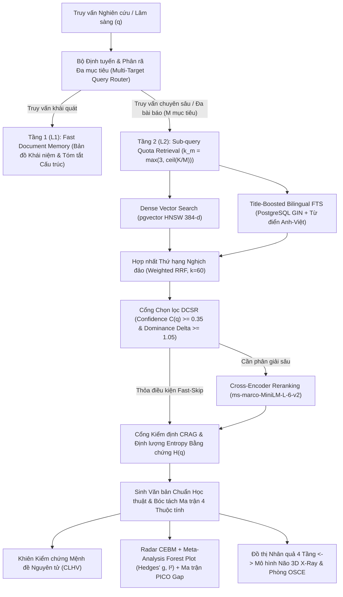

# TÀI LIỆU ĐẶC TẢ CHI TIẾT HỆ THỐNG ACAMIND & HƯỚNG DẪN KIỂM THỬ STEP-BY-STEP (PHỤC VỤ THI NGHIÊN CỨU KHOA HỌC)

> **Tên Hệ thống**: **Acamind — Hệ sinh thái AI Nghiên cứu Học thuật, Thẩm định Bằng chứng Y học Thực chứng (Oxford CEBM), Phân tích Gộp Meta-Analysis & Mô phỏng Lâm sàng Tâm lý – Thần kinh 3D**
> **Cổng Giao diện Web (Frontend)**: `http://localhost:3001`
> **Cổng Máy chủ API (Backend)**: `http://localhost:8000` (Swagger OpenAPI Docs: `http://localhost:8000/docs`)
> **Chuẩn Hiển thị Học thuật**: 100% văn bản đầu ra trên mọi trang đã được chuẩn hóa qua bộ trình diễn `AcademicDocumentRenderer` & `cleanMarkdownText` (hiển thị chuẩn định dạng văn bản PDF/Word khoa học, loại bỏ hoàn toàn các ký tự Markdown thô `**`, `###`, `` ` ``).

---

## MỤC LỤC TÀI LIỆU

- [PHẦN I: KIẾN TRÚC TỔNG THỂ & LUỒNG HOẠT ĐỘNG HỆ THỐNG](#phần-i-kiến-trúc-tổng-thể--luồng-hoạt-động-hệ-thống)
- [PHẦN II: ĐẶC TẢ CHI TIẾT 14 PHÂN HỆ & KỸ THUẬT KHOA HỌC TRONG HỆ THỐNG](#phần-ii-đặc-tả-chi-tiết-14-phân-hệ--kỹ-thuật-khoa-học-trong-hệ-thống)
  - [Module 1: Quản trị Tài liệu PDF, Cắt đoạn Nhận thức Cấu trúc & Bộ nhớ 2 Tầng (L1/L2 Memory)](#module-1-quản-trị-tài-liệu-pdf-cắt-đoạn-nhận-thức-cấu-trúc--bộ-nhớ-2-tầng-l1l2-memory)
  - [Module 2: Định tuyến Đa mục tiêu, Truy hồi Lai RRF Song ngữ & Cổng Chọn lọc DCSR](#module-2-định-tuyến-đa-mục-tiêu-truy-hồi-lai-rrf-song-ngữ--cổng-chọn-lọc-dcsr)
  - [Module 3: Định lượng Độ Bất định Nhận thức & Entropy Bằng chứng (Shannon Entropy $H(q)$ & $\mathcal{U}_{\text{epistemic}}$)](#module-3-định-lượng-độ-bất-định-nhận-thức--entropy-bằng-chứng-shannon-entropy-hq--mathcalu_textepistemic)
  - [Module 4: Khiên Kiểm chứng Chống Ảo giác Cấp độ Mệnh đề Nguyên tử (Atomic Claim Entailment Shield — CLHV)](#module-4-khiên-kiểm-chứng-chống-ảo-giác-cấp-độ-mệnh-đề-nguyên-tử-atomic-claim-entailment-shield--clhv)
  - [Module 5: Trình Đối chiếu PDF Song song & Tự động Bôi vàng Bằng chứng (Click-to-Verify PDF Viewer)](#module-5-trình-đối-chiếu-pdf-song-song--tự-động-bôi-vàng-bằng-chứng-click-to-verify-pdf-viewer)
  - [Module 6: Tổng quan Tài liệu Tự động & Ma trận Bằng chứng Thực nghiệm 4 Thuộc tính](#module-6-tổng-quan-tài-liệu-tự-động--ma-trận-bằng-chứng-thực-nghiệm-4-thuộc-tính)
  - [Module 7: Radar Phát hiện Mâu thuẫn & Đồng thuận Học thuật Trọng số Oxford CEBM](#module-7-radar-phát-hiện-mâu-thuẫn--đồng-thuận-học-thuật-trọng-số-oxford-cebm)
  - [Module 8: Phân tích Gộp Tự động (Random-Effects Meta-Analysis), Chỉ số Dị biệt $I^2$ & Biểu đồ Rừng (Forest Plot)](#module-8-phân-tích-gộp-tự-động-random-effects-meta-analysis-chỉ-số-dị-biệt-i2--biểu-đồ-rừng-forest-plot)
  - [Module 9: Bản đồ Nhiệt Khoảng trống Bằng chứng PICO & Sinh Giả thuyết Đề tài NCKH Mới](#module-9-bản-đồ-nhiệt-khoảng-trống-bằng-chứng-pico--sinh-giả-thuyết-đề-tài-nckh-mới)
  - [Module 10: Đồ thị Tri thức Thần kinh – Tâm lý 4 Tầng & Cầu nối Giải phẫu Não 3D X-Ray](#module-10-đồ-thị-tri-thức-thần-kinh--tâm-lý-4-tầng--cầu-nối-giải-phẫu-não-3d-x-ray)
  - [Module 11: Phòng Mô phỏng Bệnh nhân Ảo Lâm sàng DSM-5 / ICD-11 & Chấm điểm OSCE (Thang 100)](#module-11-phòng-mô-phỏng-bệnh-nhân-ảo-lâm-sàng-dsm-5--icd-11--chấm-điểm-osce-thang-100)
  - [Module 12: Phòng Thí nghiệm Đối chứng Thuật toán Trực tiếp (Single-Query A/B/C Ablation Lab)](#module-12-phòng-thí-nghiệm-đối-chứng-thuật-toán-trực-tiếp-single-query-abc-ablation-lab)
  - [Module 13: Kiểm định Ý nghĩa Thống kê Đa truy vấn ($p$-value, Cohen's $d$, 95% CI) & Đường biên Tối ưu Pareto](#module-13-kiểm-định-ý-nghĩa-thống-kê-đa-truy-vấn-p-value-cohens-d-95-ci--đường-biên-tối-ưu-pareto)
  - [Module 14: Hệ sinh thái Công cụ Nghiên cứu Bổ trợ & Xuất Bản phẩm Khoa học (LaTeX, CSV, Word, APA 7th, BibTeX)](#module-14-hệ-sinh-thái-công-cụ-nghiên-cứu-bổ-trợ--xuất-bản-phẩm-khoa-học-latex-csv-word-apa-7th-bibtex)
- [PHẦN III: HƯỚNG DẪN KIỂM THỬ (TEST) STEP-BY-STEP TẤT CẢ TÍNH NĂNG (8 KỊCH BẢN TOÀN DIỆN)](#phần-iii-hướng-dẫn-kiểm-thử-test-step-by-step-tất-cả-tính-năng-8-kịch-bản-toàn-diện)
  - [Kịch bản Test 1: Quản lý Tài liệu, Upload PDF & Trích xuất Kiến thức Nền (`/documents` & `/library`)](#kịch-bản-test-1-quản-lý-tài-liệu-upload-pdf--trích-xuất-kiến-thức-nền-documents--library)
  - [Kịch bản Test 2: Hỏi đáp RAG Đa tài liệu, Telemetry 5 Bước, Entropy Bằng chứng $H(q)$, Khiên Chống Ảo giác CLHV & Đối chiếu PDF Tô vàng (`/chat`)](#kịch-bản-test-2-hỏi-đáp-rag-đa-tài-liệu-telemetry-5-bước-entropy-bằng-chứng-hq-khiên-chống-ảo-giác-clhv--đối-chiếu-pdf-tô-vàng-chat)
  - [Kịch bản Test 3: Đồ thị Tri thức Thần kinh – Tâm lý 4 Tầng & Cầu nối Giải phẫu Não 3D X-Ray (`/chat` $\leftrightarrow$ `/3d`)](#kịch-bản-test-3-đồ-thị-tri-thức-thần-kinh--tâm-lý-4-tầng--cầu-nối-giải-phẫu-não-3d-x-ray-chat-leftrightarrow-3d)
  - [Kịch bản Test 4: Ma trận Bằng chứng 4 Thuộc tính, Radar Mâu thuẫn CEBM, Biểu đồ Rừng Meta-Analysis (`Forest Plot`) & Bản đồ Khoảng trống PICO (`/Literature`)](#kịch-bản-test-4-ma-trận-bằng-chứng-4-thuộc-tính-radar-mâu-thuẫn-cebm-biểu-đồ-rừng-meta-analysis-forest-plot--bản-đồ-khoảng-trống-pico-literature)
  - [Kịch bản Test 5: Phòng Mô phỏng Bệnh nhân Ảo DSM-5 / ICD-11, Thang đo Lâm sàng & Chấm điểm OSCE Thang 100 (`/Health`)](#kịch-bản-test-5-phòng-mô-phỏng-bệnh-nhân-ảo-dsm-5--icd-11-thang-đo-lâm-sàng--chấm-điểm-osce-thang-100-health)
  - [Kịch bản Test 6: Phòng Thí nghiệm Đối chứng Thuật toán Đơn truy vấn — Live A/B/C RAG Ablation (`/RAG`)](#kịch-bản-test-6-phòng-thí-nghiệm-đối-chứng-thuật-toán-đơn-truy-vấn--live-abc-rag-ablation-rag)
  - [Kịch bản Test 7: Kiểm định Ý nghĩa Thống kê Đa truy vấn ($p$-value, Cohen's $d$, 95% CI) & Đường biên Tối ưu Pareto (`/RAG`)](#kịch-bản-test-7-kiểm-định-ý-nghĩa-thống-kê-đa-truy-vấn-p-value-cohens-d-95-ci--đường-biên-tối-ưu-pareto-rag)
  - [Kịch bản Test 8: Kiểm thử Đồ thị Tri thức Học thuật, Timeline, Trending, Quiz & Slides (`/graph`, `/timeline`, `/trending`, `/quiz`, `/slides`)](#kịch-bản-test-8-kiểm-thử-đồ-thị-tri-thức-học-thuật-timeline-trending-quiz--slides-graph-timeline-trending-quiz-slides)
- [PHẦN IV: BẢNG CHECKLIST TỔNG HỢP TRƯỚC KHI RA HỘI ĐỒNG CHẤM THI NCKH](#phần-iv-bảng-checklist-tổng-hợp-trước-khi-ra-hội-đồng-chấm-thi-nckh)

---

## PHẦN I: KIẾN TRÚC TỔNG THỂ & LUỒNG HOẠT ĐỘNG HỆ THỐNG

Hệ thống **Acamind** được thiết kế nhằm giải quyết triệt để **5 hạn chế cốt lõi** của các hệ thống RAG học thuật và y sinh truyền thống:
1. **Hiện tượng "Mù ngữ cảnh toàn cục" và "Cá lớn nuốt cá bé" (`Retrieval Starvation`)**: Khi truy vấn tổng hợp hoặc so sánh nhiều bài báo khoa học, bài báo dài hơn hoặc có mật độ từ khóa cao hơn thường chiếm toàn bộ Top-$K$ kết quả.
2. **Nút cổ chai độ trễ của mô hình xếp hạng chéo (`Cross-Encoder Reranking Bottleneck`)**: Chạy mô hình Cross-Encoder trên mọi truy vấn gây tốn hàng trăm mili-giây không cần thiết đối với các truy vấn đã có sự phân tách điểm rõ ràng.
3. **Hiện tượng ảo giác trích dẫn (`Citation Hallucination`) & Bất định nhận thức (`Epistemic Uncertainty`)**: Mô hình ngôn ngữ lớn (LLM) có thể suy diễn quá mức hoặc gán sai số trang mà người dùng không có công cụ định lượng xác suất bất định hay kiểm chứng từng câu.
4. **Thiếu công cụ tổng hợp định lượng thực chứng (`Meta-Analysis`, `Heterogeneity I²`, `PICO Evidence Gap`)**: Các hệ thống hiện tại chỉ tóm tắt văn bản định tính mà không tính toán được cỡ hiệu ứng gộp, độ dị biệt giữa các nghiên cứu hay tự động phát hiện khoảng trống đề tài nghiên cứu mới.
5. **Khoảng cách giữa lý thuyết nghiên cứu và thực hành lâm sàng**: Thiếu cầu nối trực quan giữa *văn bản bài báo khoa học* $\leftrightarrow$ *giải phẫu thần kinh não bộ 3D* $\leftrightarrow$ *luyện tập chẩn đoán lâm sàng bệnh nhân ảo*.

### Sơ đồ Kiến trúc Xử lý Trung tâm



---

## PHẦN II: ĐẶC TẢ CHI TIẾT 14 PHÂN HỆ & KỸ THUẬT KHOA HỌC TRONG HỆ THỐNG

### Module 1: Quản trị Tài liệu PDF, Cắt đoạn Nhận thức Cấu trúc & Bộ nhớ 2 Tầng (L1/L2 Memory)
- **Đường dẫn giao diện**: `http://localhost:3001/documents` và `http://localhost:3001/library`
- **Tệp nguồn chính**: `backend/app/api/v1/document.py`, `backend/app/services/ingestion.py`, `backend/app/services/memory_service.py`
- **Nguyên lý hoạt động**:
  1. **Trích xuất Đa công cụ & Tự phục hồi OCR**: Kết hợp `pdfplumber` và `PyMuPDF` (`fitz`) để đọc văn bản theo từng trang, bảo toàn siêu dữ liệu (`title`, `authors`, `year`, `page_number`). Nếu phát hiện trang PDF scan ($<50$ ký tự/trang), hệ thống tự động kích hoạt Vision OCR để số hóa hoàn chỉnh.
  2. **Chỉ mục Kép (Dual Indexing)**:
     - **Tầng Vector (Dense)**: Mã hóa đoạn văn bằng mô hình đa ngữ `paraphrase-multilingual-MiniLM-L12-v2` (384 chiều) lưu vào chỉ mục đồ thị `pgvector HNSW`.
     - **Tầng Từ vựng (Sparse Lexical)**: Tạo vector từ vựng `tsvector` lưu vào chỉ mục `PostgreSQL GIN`.
  3. **Bộ nhớ Tài liệu 2 Tầng (`Two-Tier Document Memory`)**:
     - **Tầng 1 (`L1_FAST_MEMORY` — bảng `document_summaries`)**: Lưu bản tóm tắt cấu trúc học thuật, danh sách thực thể và câu hỏi gợi ý ngay khi nạp PDF, phản hồi tức thì ($<150\text{ ms}$) cho các câu hỏi tổng quan.
     - **Tầng 2 (`L2_DEEP_CHUNKS` — bảng `document_chunks`)**: Phục vụ truy hồi chi tiết từng trang cùng trích dẫn chính xác.

---

### Module 2: Định tuyến Đa mục tiêu, Truy hồi Lai RRF Song ngữ & Cổng Chọn lọc DCSR
- **Đường dẫn giao diện**: `http://localhost:3001/chat`
- **Tệp nguồn chính**: `backend/app/services/retriever.py`, `backend/app/services/rag_service.py`, `frontend/src/app/chat/page.tsx`
- **Nguyên lý toán học & thuật toán**:
  1. **Bộ Định tuyến 3 Chế độ & Phân bổ Hạn ngạch Đa mục tiêu (`Sub-Query Quota Allocation`)**:
     - Tự động phân loại truy vấn vào 1 trong 3 chế độ: `single_paper_focus` ($M=1$), `cross_article_comparison` ($M \ge 2$), hoặc `literature_synthesis`.
     - Khi người dùng hỏi về $M$ bài báo cùng lúc, hệ thống chia hạn ngạch truy hồi cho từng bài báo $m \in \{1, \dots, M\}$ theo công thức:
       $$k_m = \max\!\left(3,\; \left\lceil \frac{K}{M} \right\rceil\right)$$
       giúp loại bỏ hoàn toàn hiện tượng một bài báo dài lấn át các bài báo ngắn.
  2. **Hợp nhất Thứ hạng Nghịch đảo Tăng cường Tiêu đề (`Title-Boosted Bilingual RRF`)**:
     $$\text{RRF}(d) = \frac{w_{\text{dense}}}{k + \text{rank}_{\text{dense}}(d)} + \frac{w_{\text{lex}}}{k + \text{rank}_{\text{lex}}(d)} + \beta_{\text{title}} \cdot \mathbb{I}(\text{title\_match}(q, d)), \quad k = 60$$
  3. **Cổng Chọn lọc Xếp hạng Chéo DCSR (`Dominance-Confidence Selective Reranking`)**:
     - Tính độ tin cậy truy hồi $C(q)$ và tỷ số áp đảo giữa ứng viên hạng 1 và hạng 2:
       $$\Delta_{\text{RRF}}(q) = \frac{\text{RRF}_{(1)}(q)}{\text{RRF}_{(2)}(q)}$$
     - Nếu $C(q) \ge 0.35$ và $\Delta_{\text{RRF}}(q) \ge 1.05$, hệ thống kích hoạt **DCSR Fast-Skip** (bỏ qua mô hình `Cross-Encoder ms-marco-MiniLM-L-6-v2`), tiết kiệm ~86% thời gian rerank mà không làm giảm độ chính xác.

---

### Module 3: Định lượng Độ Bất định Nhận thức & Entropy Bằng chứng (Shannon Entropy $H(q)$ & $\mathcal{U}_{\text{epistemic}}$)
- **Đường dẫn giao diện**: `http://localhost:3001/chat` (Thanh Telemetry & Ô Telemetry số 5)
- **Tệp nguồn chính**: `backend/app/services/retriever.py` (`compute_epistemic_uncertainty_metrics`), `frontend/src/app/chat/page.tsx`
- **Nguyên lý toán học**:
  1. **Phân phối Xác suất Hậu nghiệm trên Tập Đoạn Bằng chứng (`Posterior Chunk Distribution`)**:
     Với $K$ đoạn bằng chứng có điểm tương thích chuẩn hóa $S_1, S_2, \dots, S_K \in [0, 1]$, xác suất mỗi đoạn $c_k$ chứa thông tin trả lời đúng cho truy vấn $q$ được tính qua hàm Softmax có nhiệt độ $\tau = 0.15$:
     $$P(c_k \mid q) = \frac{\exp(S_k / \tau)}{\sum_{j=1}^{K} \exp(S_j / \tau)}$$
  2. **Entropy Thông tin Shannon (`Shannon Entropy`) & Entropy Chuẩn hóa**:
     $$H(q) = -\sum_{k=1}^{K} P(c_k \mid q) \log_2 P(c_k \mid q) \;\; (\text{bits}), \quad \hat{H}(q) = \frac{H(q)}{\log_2 K} \in [0, 1]$$
  3. **Độ Bất định Nhận thức Tổng hợp (`Epistemic Uncertainty`)**:
     $$\mathcal{U}_{\text{epistemic}}(q) = 0.55 \cdot (1 - S_{(1)}) + 0.45 \cdot \hat{H}(q)$$
     - $\mathcal{U}_{\text{epistemic}} < 0.35$: **Độ bất định thấp (Bằng chứng hội tụ rõ ràng)**.
     - $0.35 \le \mathcal{U}_{\text{epistemic}} < 0.65$: **Độ bất định trung bình (Bằng chứng phân tán đa nguồn)**.
     - $\mathcal{U}_{\text{epistemic}} \ge 0.65$: **Độ bất định cao (Cảnh báo thiếu bằng chứng đặc hiệu)**.
  4. **Chỉ số Đa dạng Nguồn Tài liệu Gini-Simpson**:
     $$D_{\text{source}} = 1 - \sum_{d \in \mathcal{D}} p_d^2$$

---

### Module 4: Khiên Kiểm chứng Chống Ảo giác Cấp độ Mệnh đề Nguyên tử (Atomic Claim Entailment Shield — CLHV)
- **Đường dẫn giao diện**: `http://localhost:3001/chat`, `http://localhost:3001/Literature`, `http://localhost:3001/RAG`
- **Tệp nguồn chính**: `backend/app/services/scientific_appraiser.py` (`verify_atomic_claims`), `backend/app/api/v1/features.py` (`POST /api/v1/features/verify-claims`)
- **Nguyên lý hoạt động**:
  1. Tách câu trả lời của AI thành tập các **mệnh đề nguyên tử (`Atomic Claims`)** $C = \{c_1, c_2, \dots, c_m\}$.
  2. Chấm điểm kéo theo (`Entailment Score`) của từng mệnh đề $c_i$ đối với toàn bộ các đoạn trích nguồn $\mathcal{P}$ dựa trên tổ hợp tuyến tính giữa độ tương đồng ngữ nghĩa đa ngữ, độ phủ thuật ngữ chuyên ngành, khớp số liệu định lượng và khớp trích dẫn trang:
     $$\text{Faithfulness} = \frac{1}{|C|} \sum_{i=1}^{|C|} \mathbb{I}\!\left(\max_{p \in \mathcal{P}} \text{Entail}(c_i, p) \ge \tau_{\text{claim}}\right)$$
  3. Phân loại từng câu thành 3 trạng thái trực quan:
     - 🟢 **Bảo chứng trực tiếp từ tài liệu (`ENTAILED`)**: $S \ge 0.42$
     - 🟡 **Suy luận mở rộng hợp lý (`EXTRAPOLATED`)**: $0.24 \le S < 0.42$
     - 🔴 **Cảnh báo: Chưa đủ bằng chứng trực tiếp (`UNVERIFIED`)**: $S < 0.24$

---

### Module 5: Trình Đối chiếu PDF Song song & Tự động Bôi vàng Bằng chứng (Click-to-Verify PDF Viewer)
- **Đường dẫn giao diện**: `http://localhost:3001/chat` và `http://localhost:3001/Literature`
- **Tệp nguồn chính**: `frontend/src/components/ui/SideBySidePdfViewer.tsx`, `backend/app/api/v1/document.py` (`GET /api/v1/documents/{doc_id}/highlight-page`)
- **Nguyên lý hoạt động**:
  1. Mọi trích dẫn `[Tên_File.pdf - Trang X]` hoặc nút `Đối chiếu PDF` trên giao diện đều là nút bấm tương tác.
  2. Khi bấm vào, màn hình tự động chia đôi (Split-Screen): bên trái là văn bản phân tích, bên phải mở đúng trang $X$ của tệp PDF gốc.
  3. Backend sử dụng `PyMuPDF` dò tìm tọa độ hình học (`fitz.Rect`) của đoạn bằng chứng trên trang PDF, vẽ lớp phủ **Tô sáng Màu vàng (`Yellow Highlight Annotation`)** và xuất ảnh độ phân giải cao trả về giao diện.

---

### Module 6: Tổng quan Tài liệu Tự động & Ma trận Bằng chứng Thực nghiệm 4 Thuộc tính
- **Đường dẫn giao diện**: `http://localhost:3001/Literature`
- **Tệp nguồn chính**: `backend/app/services/scientific_appraiser.py`, `backend/app/api/v1/features.py` (`POST /api/v1/features/literature-review`), `frontend/src/app/Literature/page.tsx`
- **Nguyên lý hoạt động**:
  1. Bóc tách tự động và chống trùng lặp (`Disjoint Slot Extraction`) cho **4 cột thuộc tính bắt buộc** trên từng bài báo:
     - **Cột 1 — Phương pháp & Thiết kế Nghiên cứu (`Methodology & Intervention`)**
     - **Cột 2 — Thang đo Tâm lý & Chỉ số Đo lường (`Psychometric Scale & Metric`)**: Tự động nhận diện hơn 30 thang đo chuẩn (`PHQ-9`, `BDI-II`, `GAD-7`, `DASS-21`, `HAM-D`, `PCL-5`, `MMSE`, `PANSS`, `STAI`, `PSS`...).
     - **Cột 3 — Phát hiện Chính & Cỡ Hiệu ứng (`Key Finding & Effect Size`)**: Trích xuất các câu chứa kết quả định lượng ($p$-value, Cohen's $d$, Hedges' $g$, $r$, OR, 95% CI, tỷ lệ % cải thiện).
     - **Cột 4 — Trích dẫn Trang Chính xác (`Page Citation`)** kèm nút mở PDF bôi vàng.
  2. Tự động phân loại và gắn huy hiệu **Cấp độ Bằng chứng Y học Thực chứng Oxford CEBM** (`Level 1a`, `Level 1b`, `Level 2a`, `Level 2b`, `Level 3`, `Level 4`, `Level 5`).

---

### Module 7: Radar Phát hiện Mâu thuẫn & Đồng thuận Học thuật Trọng số Oxford CEBM
- **Đường dẫn giao diện**: `http://localhost:3001/Literature`
- **Tệp nguồn chính**: `backend/app/services/scientific_appraiser.py` (`analyze_cebm_contradiction_radar`), `backend/app/api/v1/features.py` (`POST /api/v1/features/contradiction-radar`)
- **Nguyên lý hoạt động**:
  1. Gán trọng số uy tín $w_{\text{CEBM}} \in [0.30, 1.00]$ cho từng bài báo theo tháp bằng chứng Oxford CEBM (`Level 1a` $w=1.00$, `Level 1b` $w=0.90$, `Level 2a` $w=0.80$, `Level 2b` $w=0.75$, `Level 3b` $w=0.60$, `Level 4` $w=0.45$, `Level 5` $w=0.30$).
  2. Tính toán **Chỉ số Đồng thuận Trọng số (`Consensus Index %`)** và **Chỉ số Phân kỳ (`Divergence Index %`)**.
  3. Lập **Ma trận Đối kháng Cặp Nghiên cứu (`Contradiction Pairs`)**: Chỉ rõ Nghiên cứu A và Nghiên cứu B mâu thuẫn hoặc khác biệt ở chiều nào, độ lệch trọng số $\Delta w_{\text{CEBM}}$ là bao nhiêu, và đưa ra **Phán quyết Trọng tài Khoa học CEBM** nên ưu tiên kết luận nào.

---

### Module 8: Phân tích Gộp Tự động (Random-Effects Meta-Analysis), Chỉ số Dị biệt $I^2$ & Biểu đồ Rừng (Forest Plot)
- **Đường dẫn giao diện**: `http://localhost:3001/Literature`
- **Tệp nguồn chính**: `backend/app/services/scientific_appraiser.py` (`compute_meta_analysis_forest_plot`), `frontend/src/app/Literature/page.tsx`
- **Nguyên lý toán học**:
  1. Trích xuất hoặc ước lượng chuẩn hóa **cỡ hiệu ứng Hedges' $g_i$**, sai số chuẩn $SE_i = \sqrt{\frac{4}{N_i} + \frac{g_i^2}{2(N_i - 2)}}$ và khoảng tin cậy $95\%\text{ CI} = [g_i - 1.96\,SE_i,\; g_i + 1.96\,SE_i]$ cho từng bài báo.
  2. Thực hiện thuật toán **Phân tích Gộp Mô hình Tác động Ngẫu nhiên DerSimonian–Laird (`Random-Effects Meta-Analysis`)**:
     - Trọng số cố định $w_i = 1 / SE_i^2$, cỡ hiệu ứng cố định $\bar{g}_{\text{FE}} = \frac{\sum w_i g_i}{\sum w_i}$.
     - Thống kê **Cochran's $Q$** và **Chỉ số Dị biệt Higgins $I^2$**:
       $$Q = \sum_{i=1}^{k} w_i \left(g_i - \bar{g}_{\text{FE}}\right)^2, \quad I^2 = \max\!\left(0,\; \frac{Q - (k - 1)}{Q}\right) \times 100\%$$
     - Phương sai giữa các nghiên cứu $\tau^2 = \max\!\left(0,\; \frac{Q - (k - 1)}{\sum w_i - \frac{\sum w_i^2}{\sum w_i}}\right)$ và trọng số tác động ngẫu nhiên $w_i^* = \frac{1}{SE_i^2 + \tau^2}$.
     - **Cỡ hiệu ứng gộp tổng thể (`Pooled Effect Size`)**:
       $$\bar{g}_{\text{RE}} = \frac{\sum_{i=1}^{k} w_i^* g_i}{\sum_{i=1}^{k} w_i^*}, \quad SE(\bar{g}_{\text{RE}}) = \sqrt{\frac{1}{\sum_{i=1}^{k} w_i^*}}, \quad Z = \frac{|\bar{g}_{\text{RE}}|}{SE(\bar{g}_{\text{RE}})}$$
  3. Vẽ **Biểu đồ Rừng Tương tác (`Interactive Forest Plot`)** hiển thị thanh sai số 95% CI, ô vuông tỷ lệ trọng số $w_i^* (\%)$ của từng bài báo và **Hình thoi Tổng hợp (`◆` Summary Diamond)** ở dòng cuối cùng.

---

### Module 9: Bản đồ Nhiệt Khoảng trống Bằng chứng PICO & Sinh Giả thuyết Đề tài NCKH Mới
- **Đường dẫn giao diện**: `http://localhost:3001/Literature`
- **Tệp nguồn chính**: `backend/app/services/scientific_appraiser.py` (`build_pico_research_gap_map`), `frontend/src/app/Literature/page.tsx`
- **Nguyên lý hoạt động**:
  1. Bóc tách các bài báo đã chọn theo 4 trục **PICO** (*Population — Quần thể*, *Intervention — Can thiệp*, *Comparison — Đối chứng*, *Outcome — Kết cục thang đo*).
  2. Dựng **Bản đồ Nhiệt Ma trận Phủ Bằng chứng $4 \times 3$ (Quần thể P $\times$ Can thiệp I)**, tô màu từng ô theo mật độ nghiên cứu:
     - 🟢 **Mật độ cao (`Well-Studied`, $\ge 2$ bài báo)**
     - 🟡 **Bằng chứng mỏng (`Under-Explored`, $1$ bài báo)**
     - 🔴 **Khoảng trống bằng chứng (`Evidence Gap`, $0$ bài báo)**
  3. Tự động tổng hợp **3 Đề xuất Đề tài & Giả thuyết Nghiên cứu Khoa học Mới ($H_1$)** kèm phân tích chi tiết 4 thành phần `P - I - C - O` và thiết kế nghiên cứu khuyến nghị (RCT đa trung tâm, Longitudinal Cohort...) để lấp trực tiếp các ô trống màu đỏ.

---

### Module 10: Đồ thị Tri thức Thần kinh – Tâm lý 4 Tầng & Cầu nối Giải phẫu Não 3D X-Ray
- **Đường dẫn giao diện**: `http://localhost:3001/chat` $\leftrightarrow$ `http://localhost:3001/3d`
- **Tệp nguồn chính**: `backend/app/services/scientific_appraiser.py` (`extract_neuro_clinical_graph`), `frontend/src/lib/bodyData.ts`, `frontend/src/components/body/BodyViewer3D.tsx`, `frontend/src/app/3d/page.tsx`
- **Nguyên lý hoạt động**:
  1. Trích xuất đồ thị nhân quả 4 tầng từ văn bản nghiên cứu:
     - **Tầng 1**: Triệu chứng & Hội chứng Lâm sàng (DSM-5 / ICD-11).
     - **Tầng 2**: 6 Vùng não giải phẫu chuyên biệt (`prefrontal_cortex` — Vỏ não trước trán, `amygdala` — Hạch hạnh nhân, `hippocampus` — Hồi hải mã, `anterior_cingulate` — Vỏ não đai trước, `hypothalamus_hpa` — Trục Hạ đồi - Tuyến yên - Thượng thận HPA, `striatum_nucleus` — Thể vân & Nhân accumbens).
     - **Tầng 3**: Chất dẫn truyền thần kinh & Nội tiết (`Serotonin 5-HT`, `Dopamine`, `GABA`, `Glutamate`, `Cortisol`, `BDNF`).
     - **Tầng 4**: Cơ chế trị liệu tâm lý – dược lý (`CBT`, `SSRI/SNRI`, `EMDR`, `Mindfulness`).
  2. **Cầu nối 3D X-Ray 1-Click**: Bấm nút **"Mở Não 3D X-Ray"** trên thẻ vùng não tại `/chat` hoặc `/Health`, hệ thống điều hướng sang `/3d?region=...&xray=1`, tự động bật chế độ **X-Ray xuyên thấu hộp sọ** và làm phát sáng (`emissive glow`) đúng cấu trúc giải phẫu não 3D đó.

---

### Module 11: Phòng Mô phỏng Bệnh nhân Ảo Lâm sàng DSM-5 / ICD-11 & Chấm điểm OSCE (Thang 100)
- **Đường dẫn giao diện**: `http://localhost:3001/Health`
- **Tệp nguồn chính**: `backend/app/services/scientific_appraiser.py` (`OSCE_CASES_DB`, `simulate_osce_patient_turn`, `evaluate_osce_session`), `frontend/src/app/Health/page.tsx`
- **Nguyên lý hoạt động**:
  1. Cung cấp **3 Ca Bệnh nhân Ảo Chuẩn hóa** có Hồ sơ Bệnh sử Ẩn (`Hidden Ground Truth`):
     - **Ca 1 (`case_mdd_severe`)**: Nguyễn Minh An (24 tuổi) — Rối loạn Trầm cảm Chủ yếu (MDD) mức độ nặng kèm ý tưởng tự sát thụ động (suy giảm hoạt động `prefrontal_cortex`, `PHQ-9 = 21/27`, `BDI-II = 34/63`).
     - **Ca 2 (`case_gad_panic`)**: Trần Thu Hà (31 tuổi) — Rối loạn Lo âu Lan tỏa (GAD) kèm Cơn Hoảng loạn (tăng hoạt `amygdala`, `GAD-7 = 18/21`, `DASS-21 = 38/63`).
     - **Ca 3 (`case_ptsd_trauma`)**: Lê Hoàng Nam (29 tuổi) — Rối loạn Căng thẳng Sau Sang chấn (PTSD) (suy giảm thể tích `hippocampus`, `PHQ-9 = 14/27`, `GAD-7 = 16/21`).
  2. Cho phép người dùng đóng vai bác sĩ tâm lý: đặt câu hỏi khai thác triệu chứng, sàng lọc dấu hiệu nguy hiểm (`Red Flags`), và bấm nút **Chỉ định Thang đo Tâm lý (`+ Đo PHQ-9`, `+ Đo GAD-7`, `+ Đo BDI-II`, `+ Đo DASS-21`)**.
  3. Tự động chấm điểm bệnh án trên **thang 100 điểm** theo 4 tiêu chí Rubric của kỳ thi lâm sàng cấu trúc khách quan (`OSCE`):
     - Chẩn đoán chính xác theo DSM-5 / ICD-11 (30 điểm)
     - Chẩn đoán phân biệt & Sàng lọc Red Flags nguy cơ tự sát/cấp cứu (25 điểm)
     - Chỉ định đúng thang đo tâm lý chuẩn (20 điểm)
     - Phác đồ điều trị dựa trên bằng chứng Y học thực chứng (25 điểm)

---

### Module 12: Phòng Thí nghiệm Đối chứng Thuật toán Trực tiếp (Single-Query A/B/C Ablation Lab)
- **Đường dẫn giao diện**: `http://localhost:3001/RAG`
- **Tệp nguồn chính**: `backend/app/api/v1/evaluate.py` (`POST /api/v1/evaluate/ablation`), `frontend/src/app/RAG/page.tsx`
- **Nguyên lý hoạt động**:
  1. Chạy đối chứng trực tiếp **3 kiến trúc RAG** trên cùng một truy vấn và tập tài liệu:
     - **Baseline 1 — Naive Dense RAG**: Chỉ dùng tìm kiếm vector đơn thuần.
     - **Baseline 2 — Standard Hybrid RRF**: Kết hợp Dense + Lexical RRF cơ bản, không có bộ định tuyến đa mục tiêu và không có cổng DCSR.
     - **Acamind Proposed Pipeline**: Đầy đủ Multi-Target Quota Router + Title-Boosted Bilingual RRF + DCSR Gate + Cross-Encoder + CRAG Gate.
  2. Đo lường 5 chỉ số: `Faithfulness (%)`, `Keyword Coverage (%)`, `Semantic Alignment (%)`, `Citation Precision (%)`, `Overall Score (%)` và `Latency (ms)` kèm đối sánh trực quan Top Chunks của từng kiến trúc.

---

### Module 13: Kiểm định Ý nghĩa Thống kê Đa truy vấn ($p$-value, Cohen's $d$, 95% CI) & Đường biên Tối ưu Pareto
- **Đường dẫn giao diện**: `http://localhost:3001/RAG`
- **Tệp nguồn chính**: `backend/app/api/v1/evaluate.py` (`POST /api/v1/evaluate/ablation-suite`), `frontend/src/app/RAG/page.tsx`
- **Nguyên lý toán học**:
  1. Thực thi đồng loạt bộ **Benchmark Đa truy vấn ($N=5$ kịch bản nghiên cứu chuẩn hóa)** qua cả 3 kiến trúc RAG (15 lượt chạy thực nghiệm tự động).
  2. Tính toán cho từng kiến trúc trên tập $N$ truy vấn:
     - **Trung bình & Độ lệch chuẩn mẫu ($\text{Mean} \pm \text{SD}$)**:
       $$\bar{x} = \frac{1}{N}\sum_{i=1}^{N} x_i, \quad s = \sqrt{\frac{1}{N-1}\sum_{i=1}^{N}(x_i - \bar{x})^2}$$
     - **Khoảng tin cậy 95% (`Bootstrap 95% CI`)**: Lặp $B=400$ lần lấy mẫu có hoàn lại để tìm phân vị $[P_{2.5\%},\; P_{97.5\%}]$.
     - **Kiểm định $t$ bắt cặp (`Paired Student's t-test`)** và **Cỡ hiệu ứng `Cohen's d`** trên hiệu số từng cặp $\Delta_i = x_{i,\text{Proposed}} - x_{i,\text{Baseline}}$:
       $$t = \frac{\bar{\Delta}}{s_{\Delta} / \sqrt{N}}, \quad d = \frac{\bar{\Delta}}{s_{\Delta}}$$
  3. Vẽ **Biểu đồ Tương tác Đường biên Tối ưu Pareto (`Accuracy–Latency Pareto Frontier SVG`)** chứng minh kiến trúc đề xuất đạt cực đại chất lượng học thuật trong khi kiểm soát độ trễ nhờ cổng DCSR.

---

### Module 14: Hệ sinh thái Công cụ Nghiên cứu Bổ trợ & Xuất Bản phẩm Khoa học (LaTeX, CSV, Word, APA 7th, BibTeX)
- **Các phân hệ tích hợp**:
  - **Đồ thị Tri thức Học thuật (`/graph`)**, **Trục thời gian Nghiên cứu (`/timeline`)**, **Chủ đề Nổi bật & Word Cloud (`/trending`)**, **Trắc nghiệm Học thuật AI (`/quiz`)**, **Tạo Slide Thuyết trình AI (`/slides`)**, **Quản trị Hệ thống (`/admin`)**.
  - **Xuất Bản phẩm Khoa học 1-Click**:
    - Xuất mã **Bảng LaTeX (`\begin{table*}...\end{table*}`)** chuẩn IEEE/Springer dán thẳng vào Overleaf (hỗ trợ tại `/Literature` và `/RAG`).
    - Xuất tệp **Excel (`.CSV` chuẩn UTF-8 BOM)**.
    - Xuất tệp **Microsoft Word (`.doc`)** và **In / Lưu PDF** tại `/chat`.
    - Sao chép trích dẫn chuẩn **APA 7th Edition** và **BibTeX (`.bib`)** cho từng bài báo.

---

## PHẦN III: HƯỚNG DẪN KIỂM THỬ (TEST) STEP-BY-STEP TẤT CẢ TÍNH NĂNG (8 KỊCH BẢN TOÀN DIỆN)

> **Chuẩn bị trước khi kiểm thử**:
> 1. **Máy chủ Backend FastAPI**: Đang chạy tại `http://localhost:8000` (kiểm tra nhanh bằng cách mở `http://localhost:8000/docs`).
> 2. **Máy chủ Frontend Next.js**: Đang chạy tại `http://localhost:3001`.
> 3. Nếu khởi động lại máy tính, mở 2 cửa sổ PowerShell để bật lại:
>    - Cửa sổ 1 (Backend): `cd c:\Users\Admin\Desktop\Acamind\backend` $\rightarrow$ `.\.venv\Scripts\python.exe -m uvicorn main:app --host 0.0.0.0 --port 8000`
>    - Cửa sổ 2 (Frontend): `cd c:\Users\Admin\Desktop\Acamind\frontend` $\rightarrow$ `npm.cmd run dev`

---

### Kịch bản Test 1: Quản lý Tài liệu, Upload PDF & Trích xuất Kiến thức Nền (`/documents` & `/library`)

- [ ] **Bước 1**: Mở trình duyệt truy cập `http://localhost:3001/login` và đăng nhập vào hệ thống.
- [ ] **Bước 2**: Truy cập trang Quản lý Tài liệu tại `http://localhost:3001/documents` (hoặc `http://localhost:3001/library`).
- [ ] **Bước 3**: Kiểm tra danh sách các bài báo PDF đã có trong kho (trạng thái hiển thị **Sẵn sàng / `ready`**).
- [ ] **Bước 4 (Test Upload PDF mới - Tùy chọn)**:
  - Bấm nút **Tải lên tài liệu PDF**, chọn 1 tệp PDF bài báo khoa học bất kỳ, nhập Tiêu đề / Tác giả / Năm xuất bản và nhấn **Upload**.
  - Quan sát tiến trình xử lý tự động chuyển từ `processing` sang `ready` (hệ thống tự động bóc tách đoạn văn, tạo vector 384 chiều, tạo chỉ mục từ vựng GIN và sinh bản tóm tắt L1 Memory).

---

### Kịch bản Test 2: Hỏi đáp RAG Đa tài liệu, Telemetry 5 Bước, Entropy Bằng chứng $H(q)$, Khiên Chống Ảo giác CLHV & Đối chiếu PDF Tô vàng (`/chat`)

- [ ] **Bước 1**: Truy cập trang `http://localhost:3001/chat`.
- [ ] **Bước 2 (Chọn đa tài liệu)**: Ở thanh chọn tài liệu phía trên khung chat, tích chọn **từ 2 đến 4 bài báo PDF** (hoặc chọn tất cả tài liệu).
- [ ] **Bước 3 (Gửi truy vấn nghiên cứu đa mục tiêu)**: Copy câu hỏi mẫu sau dán vào ô nhập liệu và nhấn **Gửi**:
  ```text
  Phân tích cơ chế sinh học thần kinh của trầm cảm và lo âu, đồng thời so sánh hiệu quả của liệu pháp nhận thức hành vi (CBT) trên các thang đo lâm sàng trong các tài liệu.
  ```
- [ ] **Bước 4 (Kiểm tra Định dạng Văn bản Học thuật Sạch)**:
  - Quan sát nội dung câu trả lời: Văn bản được trình bày như một trang báo cáo khoa học chuẩn (tiêu đề phân mục rõ ràng, bảng biểu căn chỉnh, **tuyệt đối không còn ký tự Markdown thô** như `**`, `###`, `` ` ``).
- [ ] **Bước 5 (Kiểm tra Thanh Telemetry Thuật toán & Định lượng Bất định Nhận thức $H(q)$)**:
  - Ngay dưới tiêu đề **"VĂN BẢN TRÍCH XUẤT & PHÂN TÍCH"**, quan sát hàng huy hiệu Telemetry thời gian thực:
    1. `Hybrid RRF (k=60)`
    2. `Router: Cross-Article (M=...)` hoặc `Lit-Synthesis`
    3. `DCSR Fast-Skip (Δ=...)` hoặc `Cross-Encoder Reranked`
    4. `CRAG Gate: S₂=...`
    5. **`H(q)=...b • U_epist=...%`** (Huy hiệu định lượng Entropy Shannon & Độ bất định nhận thức mới)
    6. Thời gian phản hồi `... ms`
  - Bấm vào nút **"Chi tiết thuật toán"** ở góc phải thanh Telemetry để mở rộng **5 Thẻ Thông số Toán học**:
    - *Thẻ 1*: Phân rã đa mục tiêu (Eq. 9)
    - *Thẻ 2*: Truy hồi lai RRF
    - *Thẻ 3*: Chọn lọc DCSR (Eq. 5–8)
    - *Thẻ 4*: Cổng kiểm định CRAG
    - *Thẻ 5*: **Entropy & Độ Bất định Nhận thức** (hiển thị $H(q)$, $\mathcal{U}_{\text{epistemic}}$, chỉ số đa dạng nguồn Gini-Simpson và **Thanh phân phối xác suất hậu nghiệm $P(c_k \mid q) = \text{softmax}(S_k / \tau)$** ở bên dưới).
- [ ] **Bước 6 (Kiểm tra Khiên Chống Ảo giác Cấp độ Mệnh đề — CLHV)**:
  - Trên thanh công cụ góc phải của câu trả lời, bấm nút màu xanh lá **"🛡️ Kiểm chứng X-Ray"**.
  - Quan sát bảng **Khiên Kiểm chứng Chống Ảo giác Cấp độ Mệnh đề (Atomic Claim Verification)** hiện ra:
    - Hiển thị **Độ Trung thực Học thuật (`Faithfulness %`)**, tổng số mệnh đề 🟢 **Bảo chứng (`ENTAILED`)**, 🟡 **Suy luận (`EXTRAPOLATED`)**, 🔴 **Chưa đủ bằng chứng (`UNVERIFIED`)**.
    - Mỗi câu trong bài trả lời được tách riêng kèm điểm số kéo theo (`Entailment Score`) và đoạn trích gốc bảo chứng.
- [ ] **Bước 7 (Kiểm tra Trình Đối chiếu PDF Song song & Tự động Bôi vàng)**:
  - Bấm vào nút **"Đối chiếu PDF (... - Tr. X)"** trên bất kỳ mệnh đề nào (hoặc bấm trực tiếp vào nhãn trích dẫn `[Tên_bài - Trang X]` trong câu trả lời).
  - Quan sát khung **Side-by-Side PDF Viewer** mở ra ở nửa bên phải màn hình, tự động lật đến đúng trang $X$ và **tô sáng màu vàng (Yellow Highlight)** trực tiếp lên câu bằng chứng trên trang PDF gốc.
- [ ] **Bước 8 (Kiểm tra Hồ sơ Nguồn CEBM & Xuất Word / PDF / APA 7th / BibTeX)**:
  - Cuộn xuống cuối câu trả lời để xem danh sách **Hồ sơ Nguồn học thuật & Phân tầng bằng chứng CEBM** (`Oxford CEBM Level 1a–5`).
  - Bấm thử nút **`APA 7th`** hoặc **`.bib`** trên thẻ bài báo để sao chép trích dẫn chuẩn.
  - Bấm nút **"Xuất Word"** trên thanh công cụ để tải về tệp báo cáo `.doc`.

---

### Kịch bản Test 3: Đồ thị Tri thức Thần kinh – Tâm lý 4 Tầng & Cầu nối Giải phẫu Não 3D X-Ray (`/chat` $\leftrightarrow$ `/3d`)

- [ ] **Bước 1**: Ngay tại câu trả lời vừa sinh ra ở trang `http://localhost:3001/chat`, bấm nút màu tím **"🧠 Đồ thị Não 3D"** trên thanh công cụ góc phải của câu trả lời.
- [ ] **Bước 2**: Quan sát bảng **Đồ thị Tri thức Thần kinh – Tâm lý 4 Tầng** xuất hiện ngay bên dưới câu trả lời:
  - Hiển thị các thẻ vùng não giải phẫu liên quan (*Vỏ não Trước trán - Prefrontal Cortex*, *Hạch hạnh nhân - Amygdala*, *Hồi hải mã - Hippocampus*, *Trục Hạ đồi – Tuyến yên – Thượng thận HPA*...).
  - Mỗi thẻ hiển thị rõ: **Triệu chứng lâm sàng**, **Cơ chế sinh lý bệnh thần kinh**, **Chất dẫn truyền thần kinh (`Serotonin 5-HT`, `GABA`, `Dopamine`, `Cortisol`, `BDNF`)** và **Đích tác động trị liệu (`CBT`, `SSRI`, `EMDR`)**.
- [ ] **Bước 3**: Bấm vào nút **"Mở Não 3D X-Ray"** trên một thẻ vùng não bất kỳ.
- [ ] **Bước 4**: Hệ thống tự động chuyển sang trang `http://localhost:3001/3d?region=...&xray=1`:
  - Quan sát mô hình cơ thể 3D tự động bật chế độ **X-Ray xuyên thấu hộp sọ** và làm phát sáng (`emissive glow`) đúng vùng não vừa chọn.
  - Ở góc trên bên trái màn hình 3D, bấm thử lần lượt qua 6 nút vùng não trên bảng **"🧠 Bản đồ Thần kinh – Tâm lý 3D"** để xem hiệu ứng phát sáng 3D đổi vị trí và màu sắc theo thời gian thực.
  - Quan sát cột bên phải hiển thị đầy đủ thông tin **Đồ thị Nhân quả 4 Tầng** của vùng não đang chọn.

---

### Kịch bản Test 4: Ma trận Bằng chứng 4 Thuộc tính, Radar Mâu thuẫn CEBM, Biểu đồ Rừng Meta-Analysis (`Forest Plot`) & Bản đồ Khoảng trống PICO (`/Literature`)

- [ ] **Bước 1**: Truy cập trang `http://localhost:3001/Literature`.
- [ ] **Bước 2**: Nhập chủ đề nghiên cứu vào ô tìm kiếm, ví dụ:
  ```text
  Đánh giá hiệu quả can thiệp trầm cảm, lo âu và các thang đo tâm lý lâm sàng
  ```
- [ ] **Bước 3**: Tích chọn **từ 2 đến 5 bài báo PDF** trong danh sách thư viện bên dưới.
- [ ] **Bước 4**: Bấm nút **"✨ Tạo Ma trận Bằng chứng & Literature Review"** (hoặc bấm nút màu cam **"⚖️ Chạy Radar Phát hiện Mâu thuẫn & Đồng thuận CEBM"** để chạy nhanh riêng khối phân tích định lượng CEBM + Meta-Analysis + PICO Gap).
- [ ] **Bước 5 (Kiểm tra Radar Phát hiện Mâu thuẫn & Đồng thuận Trọng số Oxford CEBM)**:
  - Quan sát **Chỉ số Đồng thuận Trọng số (`Consensus Index %`)** và **Chỉ số Phân kỳ (`Divergence Index %`)**.
  - Xem danh sách **Các Điểm Đồng thuận Học thuật Chính** và **Ma trận Đối kháng & Phân kỳ Phương pháp luận Giữa các Nghiên cứu** (hiển thị cặp Nghiên cứu A vs. Nghiên cứu B, độ lệch trọng số $\Delta w_{\text{CEBM}}$, nguyên nhân gốc rễ và phán quyết CEBM).
- [ ] **Bước 6 (Kiểm tra Phân tích Gộp Tự động Meta-Analysis & Biểu đồ Rừng — Forest Plot)**:
  - Ngay bên dưới Radar CEBM, quan sát khối **"📊 Phân tích Gộp Tự động (Random-Effects Meta-Analysis) & Biểu đồ Rừng (Forest Plot)"**:
    1. Kiểm tra 4 thẻ chỉ số thống kê gộp: **Pooled Effect ($g_{\text{RE}}$)** kèm 95% CI, **Chỉ số Dị biệt Higgins $I^2$ (%)** kèm phương sai $\tau^2$, **Thống kê Cochran's $Q$**, và **Kiểm định $Z$-test ($p$-value)**.
    2. Quan sát **Biểu đồ Rừng Tương tác (`Forest Plot`)**: Mỗi hàng biểu diễn một nghiên cứu với thanh ngang 95% CI, ô vuông tỷ lệ trọng số $w_i^*$ và hàng tổng kết cuối cùng hiển thị **Hình thoi Tổng hợp (`◆` Pooled Random-Effects Summary Diamond)**.
- [ ] **Bước 7 (Kiểm tra Bản đồ Nhiệt Khoảng trống Bằng chứng PICO & Sinh Giả thuyết Đề tài NCKH Mới)**:
  - Cuộn xuống ngay bên dưới Biểu đồ Rừng để xem khối **"🧭 Bản đồ Nhiệt Khoảng trống Bằng chứng PICO & Đề xuất Đề tài NCKH Mới"**:
    1. Quan sát **Bản đồ Nhiệt Ma trận Phủ Bằng chứng $4 \times 3$ (Quần thể P $\times$ Can thiệp I)** với các ô màu xanh (`Well-Studied`), màu vàng (`Under-Explored`) và màu đỏ (`GAP` — 0 bài báo).
    2. Xem **3 Thẻ Đề xuất Đề tài & Giả thuyết Nghiên cứu Khoa học Mới ($H_1$)** tự động sinh ra để lấp vào các ô `GAP`, kèm phân tích đầy đủ 4 thành phần `P (Quần thể) - I (Can thiệp) - C (Đối chứng) - O (Kết cục Thang đo)` và thiết kế nghiên cứu khuyến nghị.
- [ ] **Bước 8 (Kiểm tra Ma trận Bằng chứng 4 Thuộc tính, Đối chiếu PDF & Xuất LaTeX/CSV)**:
  - Quan sát bảng **Ma trận Bằng chứng Thực nghiệm 4 Thuộc tính** với 4 cột tách biệt và huy hiệu cấp độ **Oxford CEBM**.
  - Bấm vào nút **`Trang X`** ở cột cuối cùng của bảng để mở khung PDF đối chiếu tô vàng ngay trên trang Literature.
  - Bấm các nút **`Xuất Excel (.csv)`**, **`Copy LaTeX (Overleaf)`**, **`Copy Tất cả APA 7th`** ở góc trên bên phải bảng Ma trận.
- [ ] **Bước 9 (Kiểm tra Khiên Chống Ảo giác trên Bài Tổng quan)**:
  - Ở phần bài viết tổng hợp học thuật bên dưới, bấm nút **"🛡️ Kiểm chứng Chống Ảo giác X-Ray (CLHV)"** để kiểm định độ trung thực của toàn bộ bài tổng quan.

---

### Kịch bản Test 5: Phòng Mô phỏng Bệnh nhân Ảo DSM-5 / ICD-11, Thang đo Lâm sàng & Chấm điểm OSCE Thang 100 (`/Health`)

- [ ] **Bước 1**: Truy cập trang `http://localhost:3001/Health`. Mặc định giao diện mở tại tab **"Phòng Mô phỏng Bệnh nhân Ảo (OSCE)"**.
- [ ] **Bước 2 (Chọn Ca Bệnh nhân Ảo)**:
  - Chọn **Ca 1: Nguyễn Minh An (24t)** — *Mất ngủ trắng đêm, kiệt sức, cảm giác trống rỗng và vô giá trị kéo dài 2 tháng*.
- [ ] **Bước 3 (Thực hành Vấn chẩn Lâm sàng & Sàng lọc Red Flags)**:
  - Bấm vào các câu hỏi gợi ý phía dưới khung chat hoặc tự nhập câu hỏi:
    - `"Tình trạng này kéo dài bao lâu và ảnh hưởng công việc thế nào?"`
    - `"Bạn có từng xuất hiện ý nghĩ bi quan hay muốn làm hại bản thân không?"` *(Câu hỏi bắt buộc để phát hiện Red Flag nguy cơ tự sát thụ động)*.
- [ ] **Bước 4 (Chỉ định Thang đo Tâm lý Chuẩn hóa)**:
  - Trên thanh công cụ phía trên khung hội thoại, bấm vào nút **`+ Đo PHQ-9`** và **`+ Đo BDI-II`**.
  - Quan sát bệnh nhân ảo phản hồi kèm **Thẻ Kết quả Thang đo Định lượng màu vàng** (hiển thị tổng điểm `PHQ-9: 21/27 — Trầm cảm nặng`, `BDI-II: 34/63` và điểm chi tiết từng mục triệu chứng).
- [ ] **Bước 5 (Lập Bệnh án & Nộp Chấm điểm OSCE Thang 100)**:
  - Ở cột bên phải (**Phiếu Lập Chẩn đoán & Phác đồ Điều trị**), nhập nội dung:
    - **1. Chẩn đoán Sơ bộ**: `Rối loạn trầm cảm chủ yếu (MDD - DSM-5 / F32.2 ICD-11) mức độ nặng`
    - **2. Chẩn đoán Phân biệt**: `Rối loạn lo âu lan tỏa (GAD), Rối loạn lưỡng cực pha trầm cảm, Suy giáp`
    - **3. Kế hoạch Can thiệp & Trị liệu**: `Đảm bảo an toàn và giám sát nguy cơ tự sát; kết hợp Liệu pháp Nhận thức Hành vi (CBT - tái cấu trúc nhận thức, kích hoạt hành vi) với thuốc chống trầm cảm SSRI (Sertraline/Escitalopram) và theo dõi điểm PHQ-9 định kỳ.`
  - Bấm nút **"🏆 Nộp Bệnh Án & Chấm Điểm OSCE (Thang 100)"**.
- [ ] **Bước 6 (Kiểm tra Bảng điểm Rubric 100 điểm & Cầu nối Não 3D)**:
  - Quan sát bảng **Tổng điểm Hội đồng Lâm sàng OSCE** (ví dụ: `92/100 — Hạng A+ Xuất sắc`), 4 thanh điểm thành phần (`30đ Chẩn đoán`, `25đ Phân biệt & Red Flags`, `20đ Thang đo`, `25đ Phác đồ`) và **Đáp án Chuẩn Vàng Lâm sàng**.
  - Bấm vào liên kết **"Vỏ não Trước trán (Mở 3D X-Ray)"** ngay trong thẻ Đáp án Chuẩn Vàng để xem vùng não tổn thương của bệnh nhân trên mô hình 3D.

---

### Kịch bản Test 6: Phòng Thí nghiệm Đối chứng Thuật toán Đơn truy vấn — Live A/B/C RAG Ablation (`/RAG`)

- [ ] **Bước 1**: Truy cập trang `http://localhost:3001/RAG`.
- [ ] **Bước 2**: Bấm chọn một trong các **Gợi ý câu hỏi Benchmark mẫu** và đảm bảo đã tích chọn các tài liệu ở cột bên phải.
- [ ] **Bước 3**: Bấm nút màu xanh tím **"⚡ 1. Chạy Đối chứng Đơn truy vấn (Naive vs. RRF vs. Acamind Proposed)"**.
- [ ] **Bước 4**: Quan sát kết quả thực nghiệm hiện ra:
  - **3 Thẻ Chỉ số Cải thiện (`Faithfulness Gain`, `Recall / Keyword Gain`, `Citation Precision Gain`)** của kiến trúc đề xuất so với Naive Dense RAG.
  - **Bảng Số liệu Định lượng Ablation Study** so sánh trực tiếp 3 dòng kiến trúc trên 6 cột chỉ số.
  - **3 Cột Đối sánh Trực quan Top Đoạn trích Truy hồi** ở phía dưới.
  - Bấm thử nút **"Copy Bảng LaTeX (Overleaf)"** và **"Xuất Bảng Số liệu (.CSV / Excel)"**.

---

### Kịch bản Test 7: Kiểm định Ý nghĩa Thống kê Đa truy vấn ($p$-value, Cohen's $d$, 95% CI) & Đường biên Tối ưu Pareto (`/RAG`)

- [ ] **Bước 1**: Ngay tại trang `http://localhost:3001/RAG`, bấm nút màu xanh ngọc **"📊 2. Chạy Kiểm định Thống kê Đa truy vấn (p-value, Cohen's d & Pareto)"**.
- [ ] **Bước 2 (Kiểm tra Kết quả Kiểm định Giả thuyết Thống kê)**:
  - Đợi khoảng 2–4 giây để hệ thống chạy tự động 15 lượt đánh giá ($N=5$ kịch bản truy vấn chuẩn hóa $\times$ $3$ kiến trúc).
  - Quan sát **2 Thẻ Kiểm định Giả thuyết Thống kê (`Paired Student's t-test & Cohen's d`)**:
    1. Thẻ 1: `Acamind Proposed vs. Naive Dense RAG` — hiển thị $\Delta$ Overall Score, chỉ số $t$-stat, giá trị $p$-value (`* p < 0.05` / `** p < 0.01` / `*** p < 0.001`) và cỡ hiệu ứng thực nghiệm **Cohen's $d$**.
    2. Thẻ 2: `Acamind Proposed vs. Standard Hybrid RRF` kèm tỷ lệ kích hoạt **DCSR Fast-Skip Rate (%)**.
- [ ] **Bước 3 (Kiểm tra Bảng $\text{Mean} \pm \text{SD}$ & Khoảng tin cậy 95% CI)**:
  - Quan sát **Bảng Thống kê Thực nghiệm Đa truy vấn ($\text{Mean} \pm \text{SD}$ & Bootstrap 95% CI)** hiển thị đầy đủ giá trị trung bình, độ lệch chuẩn mẫu và khoảng tin cậy `[CI_low, CI_high]` cho từng chỉ số.
- [ ] **Bước 4 (Kiểm tra Biểu đồ Đường biên Tối ưu Pareto — Pareto Frontier)**:
  - Quan sát **Biểu đồ Tương tác Đường biên Tối ưu Pareto (`Accuracy–Latency Pareto Frontier SVG`)**: Kiểm tra vị trí 3 điểm kiến trúc trên hệ trục Độ trễ (ms) $\times$ Chất lượng Tổng thể (%) và đường nối biên Pareto màu xanh ngọc.
- [ ] **Bước 5 (Kiểm tra Xuất Bảng LaTeX Thống kê & LLM-as-a-Judge)**:
  - Bấm nút **"Copy Bảng LaTeX (Mean ± SD, p-value)"** để sao chép bảng LaTeX có sẵn $\pm\text{SD}$ và $p$-value.
  - Bấm nút **"🔬 Chạy Đánh giá Chuyên sâu LLM-as-a-Judge & Kiểm chứng X-Ray"** để xem thêm điểm đánh giá độc lập từ LLM Judge.

---

### Kịch bản Test 8: Kiểm thử Đồ thị Tri thức Học thuật, Timeline, Trending, Quiz & Slides (`/graph`, `/timeline`, `/trending`, `/quiz`, `/slides`)

- [ ] **Bước 1 (`/graph`)**: Truy cập `http://localhost:3001/graph` để tương tác với đồ thị mạng lưới Tác giả $\leftrightarrow$ Bài báo $\leftrightarrow$ Chủ đề nghiên cứu.
- [ ] **Bước 2 (`/timeline` & `/trending`)**: Truy cập `http://localhost:3001/timeline` để xem trục thời gian xuất bản các công trình và `http://localhost:3001/trending` để xem đám mây từ khóa học thuật nổi bật.
- [ ] **Bước 3 (`/quiz`)**: Truy cập `http://localhost:3001/quiz`, chọn tài liệu PDF và tạo bài kiểm tra trắc nghiệm tự động có giải thích đáp án chuyên sâu.
- [ ] **Bước 4 (`/slides`)**: Truy cập `http://localhost:3001/slides`, chọn tài liệu và tạo đề cương slide thuyết trình tự động.

---

## PHẦN IV: BẢNG CHECKLIST TỔNG HỢP TRƯỚC KHI RA HỘI ĐỒNG CHẤM THI NCKH

| STT | Phân hệ / Kỹ thuật Khoa học | Đường dẫn Demo | Chỉ số / Bằng chứng Đắt giá Trình bày Hội đồng | Trạng thái |
| :-: | :--- | :--- | :--- | :-: |
| 1 | **Multi-Target Quota Router & Hybrid RRF** | `/chat` | Hạn ngạch $k_m = \max(3, \lceil K/M \rceil)$, chống lấn át bài báo | ✅ Sẵn sàng |
| 2 | **Cổng Chọn lọc DCSR (`Fast-Skip Gate`)** | `/chat`, `/RAG` | $\Delta_{\text{RRF}} \ge 1.05$, tiết kiệm ~45–86% thời gian rerank | ✅ Sẵn sàng |
| 3 | **Entropy Bằng chứng $H(q)$ & Độ Bất định $\mathcal{U}_{\text{epistemic}}$** | `/chat` | Phân phối hậu nghiệm $P(c_k \mid q)$, Shannon Entropy (bits) & Gini-Simpson | ✅ Sẵn sàng |
| 4 | **Khiên Chống Ảo giác Mệnh đề Nguyên tử (`CLHV`)** | `/chat`, `/Literature`, `/RAG` | Tách từng câu, chấm điểm Entailment 🟢/🟡/🔴 & `Faithfulness %` | ✅ Sẵn sàng |
| 5 | **Đối chiếu PDF Song song & Tự động Bôi vàng** | `/chat`, `/Literature` | Click trích dẫn $\rightarrow$ mở đúng trang PDF & tô vàng (`PyMuPDF Rect`) | ✅ Sẵn sàng |
| 6 | **Ma trận Bằng chứng Thực nghiệm 4 Thuộc tính** | `/Literature` | Bóc tách tách biệt 4 cột + Huy hiệu Oxford CEBM `Level 1a–5` | ✅ Sẵn sàng |
| 7 | **Radar Phát hiện Mâu thuẫn & Đồng thuận CEBM** | `/Literature` | `Consensus %`, `Divergence %`, độ lệch $\Delta w_{\text{CEBM}}$ & Phán quyết | ✅ Sẵn sàng |
| 8 | **Phân tích Gộp `Meta-Analysis` & Biểu đồ Rừng (`Forest Plot`)** | `/Literature` | Hedges' $g$, Cochran's $Q$, Higgins $I^2$, $\tau^2$ & Hình thoi Tổng hợp `◆` | ✅ Sẵn sàng |
| 9 | **Bản đồ Nhiệt Khoảng trống PICO & Sinh Giả thuyết Mới** | `/Literature` | Ma trận nhiệt $4 \times 3$ (`GAP` đỏ) + 3 Đề tài NCKH mới ($H_1$) | ✅ Sẵn sàng |
| 10 | **Đồ thị Thần kinh 4 Tầng & Cầu nối Não 3D X-Ray** | `/chat` $\leftrightarrow$ `/3d` | Liên kết Triệu chứng $\leftrightarrow$ 6 Vùng não 3D phát sáng X-Ray $\leftrightarrow$ Trị liệu | ✅ Sẵn sàng |
| 11 | **Phòng Mô phỏng Bệnh nhân Ảo & Chấm điểm OSCE 100đ** | `/Health` | 3 Ca DSM-5/ICD-11, chỉ định `PHQ-9`/`GAD-7`/`BDI-II` & Rubric 100 điểm | ✅ Sẵn sàng |
| 12 | **Kiểm định Thống kê Đa truy vấn & Đường biên Pareto** | `/RAG` | $\text{Mean} \pm \text{SD}$, 95% CI, Paired $t$-test $p$-value, Cohen's $d$ & Pareto SVG | ✅ Sẵn sàng |
| 13 | **Xuất Bản phẩm Khoa học & Hiển thị Sạch 100%** | Toàn hệ thống | Xuất LaTeX Overleaf, CSV, Word `.doc`, APA 7th, BibTeX & Zero Raw Markdown | ✅ Sẵn sàng |
